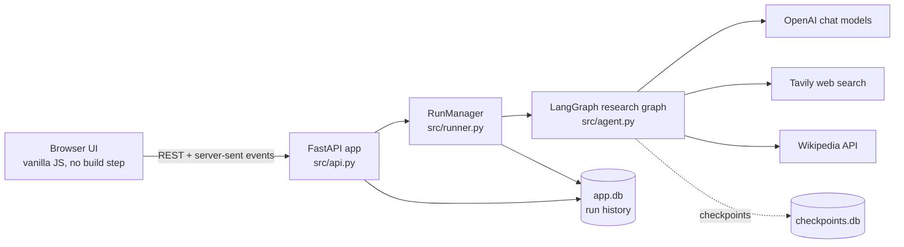
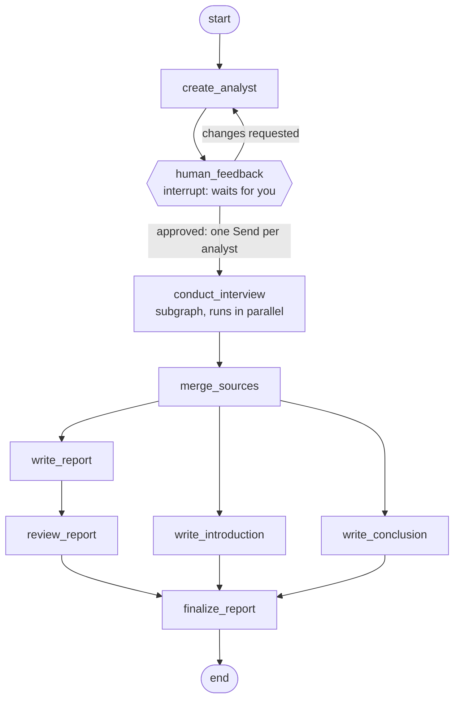
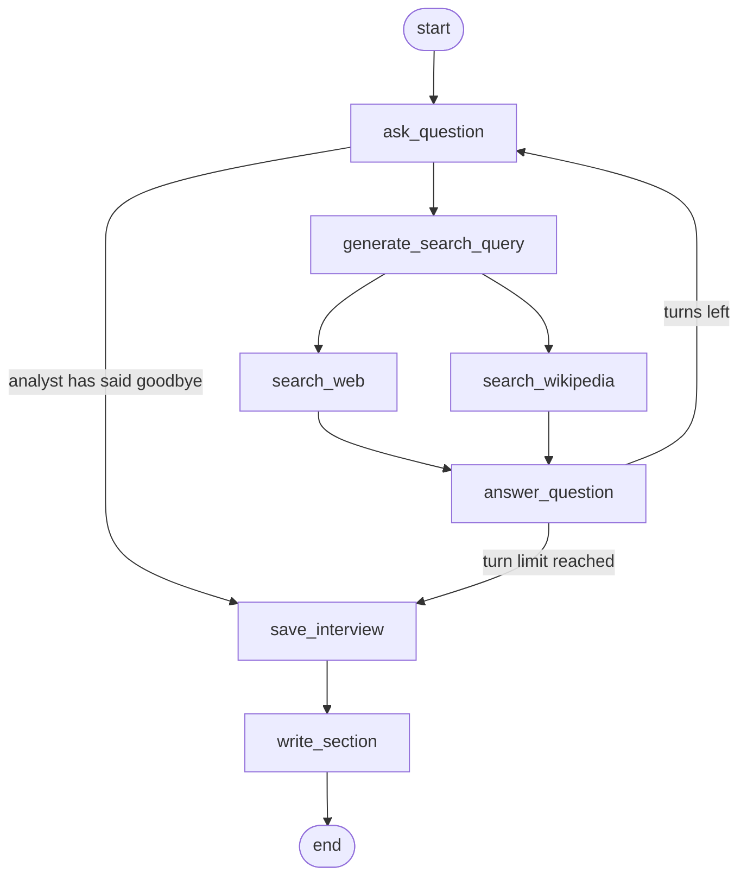

# research-agent

A multi-agent research assistant built on LangGraph. Give it a topic and it assembles a team of AI analysts, lets you review the team, has every analyst interview an "expert" that can only answer from retrieved web and Wikipedia sources, and merges the interviews into one report with numbered citations. A web UI (English / Türkçe) shows the work live, keeps a history and exports the result.

## Demo

<!-- Add the demo video here. On GitHub, open this file in the editor and drag research-agent-demo.mp4 into this spot: GitHub uploads it and inserts a link on its own line, which shows as a video player. -->

## Why this exists

A single prompt to a language model gives a fluent answer with no evidence behind it. This project is built around the opposite rule: **nothing goes into the report unless it was retrieved, and every claim carries a citation that code, not the model, has verified.**

- **Several viewpoints instead of one.** The topic is split into themes and each theme gets its own analyst, so the report covers the subject from different angles.
- **A human in the loop.** The team is shown before any money is spent. You rename, add or remove analysts, or describe changes and regenerate.
- **Grounded answers.** The expert answers only from the sources it was handed. When a search comes back empty it says so instead of improvising, and the report flags the gap.
- **Trustworthy sources.** Search results are filtered, ranked by authority and relevance, and finally picked by a model, so official documentation and primary research win over SEO pages.
- **Citations built in code.** The model writes `[n]` markers; code numbers the retrieved documents, rewrites the markers and builds the Sources section. A source that was never retrieved cannot appear.
- **A fact-check pass.** The finished report is compared with the sources it cites and unsupported claims are corrected.

## How a research runs

1. **Team.** An LLM proposes 1–6 analysts for the topic. You edit them or ask for a different team, then approve.
2. **Interviews.** Every analyst interviews the expert in parallel (three questions each). For every question a search query is generated, then the web and Wikipedia are searched with it, and the expert answers from the numbered results.
3. **Report.** Each interview becomes a report section. The sections are merged into an insights body organised under theme sub-headings, an introduction and a conclusion are written alongside it, the body is fact-checked, and the citations are finalised.

Reports can be written in English or Türkçe. The interface language is switched independently.

## Architecture



A research is a background task on the server. The UI only follows it: it can disconnect, reload or reconnect at any point without losing anything.

### The research graph

[src/agent.py](src/agent.py) is the top-level LangGraph `StateGraph`. The interviews are a subgraph that is fanned out with `Send`, one instance per analyst.



### The interview subgraph

[src/answering_question.py](src/answering_question.py): one analyst, one expert, a few turns.



### Design decisions

**Citations are built in code.** Each interview section is written against its own numbered source list. `merge_sources` maps those local numbers to one global numbering by URL and drops markers that point at nothing. `finalize_report` then:

1. removes any Sources section the model wrote itself,
2. tidies the markers: moves them before the sentence's punctuation, merges neighbouring groups into one sorted group, and keeps at most three per statement (the most authoritative ones, see below),
3. renumbers the sources by first appearance and drops sources nobody cited, then sorts the groups again, and
4. appends a Sources section built from what was really retrieved. Titles lose site names, taglines and `(PDF)` markers, and very long ones are shortened. Titles cut short by the search are completed from the URL when it matches; otherwise the cut-off ellipsis and any dangling words are trimmed.

If the introduction or conclusion comes back without a single citation although the sections have them, it is asked for once more with a reminder.

**Source quality is a pipeline, not a prompt.** For every web search:

1. Tavily is asked for up to 20 results, excluding social media, video, user-document and forum sites.
2. Code drops untrustworthy hosts (odd ports, bare IP addresses, free-DNS mirrors, free TLDs, redirect links) and barely relevant pages, pushes down company service, consultancy and marketing pages and course catalogs, and ranks the rest by relevance plus an authority bonus. The bonus (`.gov`, `.edu`, academic and standards domains, `docs.` hosts) only applies when the page is actually relevant. At most two results per site.
3. A fast model picks up to five of the ten best candidates and may pick fewer. Official documentation and primary sources come first; in-depth posts by named practitioners, including on blog platforms, are welcome.
4. For a report in a language other than English, the web is searched with the query in the report language and in English (official documentation is mostly English), and the model chooses from both.

Wikipedia is searched in the report language with a single request per question, which keeps anonymous rate limits manageable.

**The human approves before the expensive part.** `human_feedback` uses LangGraph's `interrupt`. The run pauses with a checkpoint and resumes with `Command(resume=...)` carrying either feedback text or the edited team.

**Runs survive disconnects and restarts.** Graph progress is written to SQLite checkpoints. The server emits events with increasing ids, so a reconnecting client asks for everything after the last id it saw. A stopped, failed or interrupted run can be resumed from its last checkpoint; at startup, runs that were still marked running are marked interrupted.

**The fact-check is a separate pass.** After the body is written, a model compares it with the cited sources and lists claims that are unsupported, contradicted or invented, as well as sentences whose own framing the cited evidence contradicts. A second call rewrites the report to fix them. The revision is only accepted if it kept at least half of the original text, and the flagged issues are shown in the UI. If the check itself fails, the unreviewed draft is kept and a warning is added.

**Interview settings travel in one key.** The interview state carries language and turn limit in a single `options` dict. A subgraph writes every key it shares with its parent back, and parallel interviews would collide on plain keys.

**Cost is visible.** A LangChain callback counts tokens and calls per run; with prices configured it also shows an estimated cost. The numbers are saved with the run.

**Basic hardening is built in.** Optional API key (constant-time comparison), a per-client hourly rate limit, a cap on concurrent researches, strict security headers with a content security policy, sanitised error messages with a reference id (details stay in the server log), validated and length-limited inputs, and reports rendered through DOMPurify.

## Tech stack

| Layer | Technology | Used for |
| --- | --- | --- |
| Agent orchestration | [LangGraph](https://langchain-ai.github.io/langgraph/) 1.2 | State graphs, subgraphs, `Send` fan-out, `interrupt` / `Command` human-in-the-loop, checkpointing, custom stream events |
| LLM layer | [LangChain](https://python.langchain.com/) 1.4, `langchain-openai` | `ChatOpenAI`, structured output through function calling, token usage callbacks |
| Language models | OpenAI chat models (default `gpt-6-luna`) | Analysts, interviews, sections, report, fact-check; an optional cheaper model for search queries and source selection |
| Web search | [Tavily](https://tavily.com) through `langchain-tavily` | Advanced-depth search with domain exclusion |
| Encyclopedia | Wikipedia MediaWiki API through `requests` | Article introductions in the report language, throttled and rate-limit aware |
| Backend | [FastAPI](https://fastapi.tiangolo.com/), Uvicorn, Pydantic 2 | REST API, server-sent events, request validation, static files |
| Persistence | SQLite: `sqlite3` for history, `aiosqlite` with `langgraph-checkpoint-sqlite` for checkpoints | Run history and resumable graph state |
| Frontend | Plain HTML, CSS and ES modules, no build step | Live UI, i18n (English / Türkçe), light and dark theme following the system |
| Frontend libraries | [marked](https://marked.js.org/) 12.0.2 and [DOMPurify](https://github.com/cure53/DOMPurify) 3.1.6, vendored in `web/vendor` | Markdown rendering and sanitising |
| Observability | LangSmith (optional) | Tracing every run |
| Tooling | pytest, httpx, Playwright, ruff, GitHub Actions | Offline graph and API tests, browser tests, linting, CI |
| Packaging | Docker (python 3.12-slim) | Non-root image with a health check and a data volume |
| Config | python-dotenv | `.env` loaded at startup |

Python 3.11 or newer (developed and tested on 3.12).

## Project layout

```text
main.py                     ASGI entrypoint: uvicorn main:app
langgraph.json              graphs exposed to LangGraph Studio
src/
  agent.py                  research graph (team -> interviews -> report)
  answering_question.py     interview subgraph
  creating_analysts.py      analyst-team graph on its own (for Studio)
  api.py                    FastAPI app and routes
  runner.py                 background runs, event buffer, SSE replay, error mapping
  store.py                  SQLite run history
  security.py               API key, rate limiter, security headers
  usage.py                  token and cost tracking
  settings.py               environment settings and fixed research parameters
  utils/
    nodes.py                graph nodes (LLM calls, search, report, fact-check)
    edges.py                routing between nodes, interview fan-out
    states.py               graph state definitions
    objects.py              Pydantic schemas (analyst, search query, review, ...)
    prompts.py              every prompt
    tools.py                Tavily and Wikipedia search
    ranking.py              result filtering, authority ranking, title cleanup
    sources.py              citation numbering, tidying and the Sources section
    languages.py            report languages and their labels
    models.py               ChatOpenAI factories
web/                        the UI (index.html, app.js, api.js, render.js, i18n.js, CSS)
tests/                      offline tests, plus browser tests in tests/e2e
Dockerfile, .github/        container image and CI
```

## Run it

You need an [OpenAI](https://platform.openai.com) key and a [Tavily](https://tavily.com) key.

```bash
python -m venv .venv && source .venv/bin/activate      # Windows: .venv\Scripts\activate
pip install -r requirements.txt
cp .env.example .env                                    # fill in OPENAI_API_KEY and TAVILY_API_KEY
uvicorn main:app --reload
```

Open http://127.0.0.1:8000.

With Docker (the `/data` volume keeps history and checkpoints; `.env` is mounted rather than passed with `--env-file`, which would keep the quotes around quoted values). If port 8000 is taken, change the left-hand number of `-p`.

```bash
docker build -t research-agent .
docker run -p 8000:8000 -v "$(pwd)/.env:/app/.env:ro" -v research-data:/data research-agent
```

## Configuration

Everything is read from the environment (`.env`) when the server starts, so restart it after editing `.env` (`uvicorn --reload` only restarts on `.py` changes). Copy [.env.example](.env.example) to `.env` and fill in:

| Variable | Purpose |
| --- | --- |
| `OPENAI_API_KEY` | Required. Key for the OpenAI models |
| `TAVILY_API_KEY` | Required. Key for Tavily web search |
| `WIKIPEDIA_USER_EMAIL` | Recommended. Your contact address, sent in the Wikimedia User-Agent. Without it Wikipedia throttles anonymous clients much sooner, so searches may come back empty |
| `LANGSMITH_API_KEY` | Optional. LangSmith key for tracing every run |
| `LANGSMITH_TRACING_V2` | `true` turns LangSmith tracing on (`false` in `.env.example`) |
| `LANGSMITH_PROJECT` | LangSmith project the traces go to (`research-agent`) |
| `LANGSMITH_ENDPOINT` | LangSmith API endpoint (`https://api.smith.langchain.com`) |

The server has a few more optional settings (model names, timeouts, limits, data directory); see [src/settings.py](src/settings.py). **Before exposing the app to anyone else, set `APP_API_KEY`:** without it anyone who can reach the server can spend your OpenAI and Tavily credits. The UI asks for the key once per browser tab.

The UI asks for the topic, the report language and the number of analysts (1–6). Every research runs at full strength: three questions per analyst, advanced Tavily search with up to five sources chosen from the ten best candidates, and a fact-check of the finished report. These are constants in [src/settings.py](src/settings.py).

## The web UI

A four-step flow (topic, team, interviews, report) with:

- editable analyst cards, regeneration with written feedback, and approval;
- live interview chat with a trace of every search and what it found, and the report text streaming in as it is written;
- a report view with a table of contents, source list, fact-check notes and warnings;
- copy as Markdown, download as `.md`, and print / save as PDF through the browser;
- a history of past researches that can be reopened, resumed or deleted, with tokens, time and optional cost per run;
- a Stop button, and automatic reconnection after a reload or a dropped connection.

## HTTP API

A run is a background task on the server: closing the tab does not stop it, and a refreshed page picks it up again. With `APP_API_KEY` unset, FastAPI's interactive docs are at `/docs`.

| Route | Description |
| --- | --- |
| `POST /api/research` | Start. Body `{topic, max_analyst, language}` → `{thread_id}` |
| `GET /api/research/{id}/events?after=N` | Server-sent events of the current run; replays from event `N`, so reconnecting loses nothing |
| `GET /api/research/{id}` | Saved state: status, analysts, report, sources, warnings, usage |
| `POST /api/research/{id}/feedback` | Body `{feedback, analysts?}`. Empty `feedback` approves the team (with optional edited `analysts`); text regenerates it |
| `POST /api/research/{id}/cancel` / `resume` | Stop a run / continue it from its last checkpoint |
| `GET /api/research`, `DELETE /api/research/{id}` | History |
| `GET /api/research/{id}/export` | Download the report as Markdown |
| `GET /api/health` | Key status and languages |
| `GET /api/auth/check` | Checks the `APP_API_KEY` the UI was given (`401` if it is wrong) |

A research moves through the statuses `running`, `awaiting_approval`, `done`, `error`, `cancelled` and `interrupted`. Event names: `analysts`, `interview_start`, `message`, `search`, `interview_step`, `stage`, `draft` (report text as it is written), `usage`, `report`, `error`, `cancelled`, `done`.

## LangGraph Studio

```bash
langgraph dev
```

The graphs in [langgraph.json](langgraph.json) (`research_agent`, `question_answer_graph`, `create_analysts`) run separately. The interview graph takes its settings in one `options` dict: `{"language": "en", "max_num_turns": 3}`.

## Development

```bash
pip install pytest httpx ruff playwright
ruff check .
pytest -q
```

The whole graph is tested offline with a scripted chat model and stubbed searches ([tests/fakes.py](tests/fakes.py)), so no API keys are needed. The tests cover the graph end to end, the citation and ranking logic, the HTTP API (streaming, replay, cancel and resume, limits, auth, headers) and the helpers. The browser tests in `tests/e2e` drive the real UI against a real server; they need a browser (`playwright install chromium`, or `E2E_BROWSER_CHANNEL=msedge` to use an installed Edge) and are skipped without one. CI ([.github/workflows/ci.yml](.github/workflows/ci.yml)) runs ruff and the full test suite.

For prompt-level debugging set `LANGSMITH_TRACING_V2=true` and `LANGSMITH_API_KEY` to trace every run in LangSmith.

### Evals

The tests check that the code works; they cannot tell whether the reports got better or worse. [evals/](evals) can. It runs the real agent on a fixed set of topics ([evals/cases.json](evals/cases.json)) and scores the reports. The set is balanced on purpose: technical, medical, local, economics, cultural and opinion topics in English and Türkçe, fictional topics and questions with a false premise that must be refused or corrected, and their opposites (a real but unusual topic and a question with a true premise) that must not be. An eval that only rewards refusing would reward an agent that always refuses.

```bash
python -m evals.run --smoke --yes                          # 3 English cases
python -m evals.run --yes --label before-change            # all 14 cases
python -m evals.run --yes --baseline evals/results/<run>   # compare with an earlier run
python -m evals.run --yes --trials 3 --cases rag-en        # three isolated tries of one case: pass@3, pass^3
python -m evals.run --rescore evals/results/<run> --yes    # score saved reports again, no agent run
python -m evals.canary evals/results/<run> --yes           # check the judge against claims with a known answer
```

A run calls the real models and search, so it spends OpenAI and Tavily credits; without `--yes` it only prints the plan. Reports, sources and scores are saved under `evals/results/` (not committed).

What is scored. Wherever code can decide, code decides; the model judge is used only where it has to be.

- **Hard checks** (free, no model): the report has an introduction, body and conclusion; every `[n]` resolves to a source and every source is cited; at most three citations per statement, sorted, before the punctuation; introduction, body and conclusion all carry citations; no duplicate sources (same URL, or the same title on the same site); no blocked hosts; no cut-off or very long titles; no sentences in the wrong language (for example an English quotation in a Türkçe report). It also reports word count, sub-headings, source count, the share of authoritative sources, the largest share held by one site and the number of marketing pages. The summary shows how often each check passes: a check that fails in every case is more likely broken than ten bad reports, and one that never fails only guards against regressions.
- **Figures** (free, no model): every number in a cited sentence must appear in a source that sentence cites. A figure the report works out itself (a sum, a difference) is listed too, so read the listed rows before calling one invented.
- **Faithfulness** (model judge): the report is split into its cited sentences (up to 24 per report, evenly sampled). For each one the judge first copies, word for word, the passage of a cited source that backs or contradicts it, reasons about it, then gives a verdict: supported, partial, unsupported, contradicted, not a claim, or unknown (it may decline to guess). Code then checks that the quote really is in a cited source; a favourable verdict without a real quote becomes `unverified`. A batch shows the judge the sources of all its sentences together, and it sometimes quoted a source that the sentence does not cite, so an `unverified` sentence is asked about again, alone and with only its own sources. The score is (supported + ½ partial) / judged claims; unsupported, contradicted and unverified claims are also counted on their own, and unknown ones are left out and counted.
- **Coverage** (model judge, one call per point): each normal case lists the key points a good report must make, written by hand from well-established facts. A point is covered only with a quote that code finds in the report.
- **Honesty criteria** (model judge, one call per criterion): every criterion of a fictional, false-premise, true-premise or real-topic case is graded on its own, and the case passes only when all are met.
- **Fact-check work**: how many problems the app's own fact-check found in each report (`review_issues`), how many it could not fix (`review_unfixed`) and how many fact-checks failed outright (`review_failed`). A report that needed many fixes was written less carefully even if the fixed report scores well. The figures of the introduction and the conclusion are fixed separately and are not counted here.
- **Tries**: with `--trials N` each case runs N times from a clean state. A try passes when every hard check holds and no honesty criterion fails; the summary gives pass@N (at least one try passes) and pass^N (every try passes), which is the one that matters for an agent people rely on.
- **Cost**: tokens and seconds per case. Measured on the English smoke set: roughly 70–80k tokens for the agent (two analysts) and 14–29k for the judge per case, and a full run of the 14 cases is about 1.3 million tokens. Türkçe cases cost more.

#### Is the judge right?

Anthropic's guidance for model graders is to calibrate them against known answers before trusting their numbers. `evals.canary` takes the reports of an earlier run and builds claims whose right verdict is known without asking any model: an unchanged sentence, the same sentence citing a source on another topic, a figure replaced by one that no source contains, and (English only) a reversed word such as increase to decrease. It judges them without telling the judge which is which and prints how many it caught, which unchanged sentences it rejected and which altered ones it let through.

On the three smoke reports (judge version `61d58ad9`): none of 32 unchanged sentences was rejected; all 27 sentences citing an unrelated source were caught; of 8 subtly altered sentences (a changed figure or a reversed word), 4 were caught outright, 2 only as partial and 2 were missed (a "cannot" in the second half of a sentence whose first half the source backs).

Read the numbers with these limits in mind:

- That is a small sample, and the judge prompt was revised once after the first calibration, so those numbers are no longer independent evidence. Run the canary again whenever the judge prompt, the judge model or the way verdicts are reached changes; the judge version printed with every run changes with them, and `--baseline` warns when a baseline was graded by a different version.
- Subtle changes inside a long sentence are the judge's weak spot: faithfulness is closer to an upper bound than an exact figure, and a changed figure is often graded partial, which is why figures are also checked in code.
- The default judge is the model that also writes the reports, so they can share blind spots; `--judge-model` picks another one.
- The judge reads the first 2,500 characters of the text the agent kept for each source (the sources of the smoke set are shorter than that), so a claim backed only by a later part of a longer page would count as unsupported.
- Fourteen cases, one run each, with non-deterministic models and search: differences of a few points are noise, which is what `--trials` is for. Key points that every report already makes only guard against regressions; add harder ones as the agent improves.
- The authority share uses the app's own domain heuristic (a primary source such as nobelprize.org is not counted), so it describes the source mix, not whether a report is right.

## Good to know

- **Stop** cancels the run at the next graph step. A model call already in flight is not interrupted and its result is discarded, so you may still be billed for it.
- Reports are AI-generated. The fact-check reduces unsupported claims but does not remove the need to read the sources.
- Reports in a language other than English run two web searches per question (native and English), which roughly doubles Tavily usage.
- Wikipedia is searched only in the report language, and only the article introductions are used.
- Run state, the event buffer and the rate limiter live in the memory of one server process. History and checkpoints are in SQLite, so a restart loses no research, but the app is not meant to run as several replicas behind a load balancer.
- Source titles are cleaned by rules, not by a model. A page with a generic or very long title can still look odd in the Sources list.
- Only English and Türkçe are supported as report languages.
